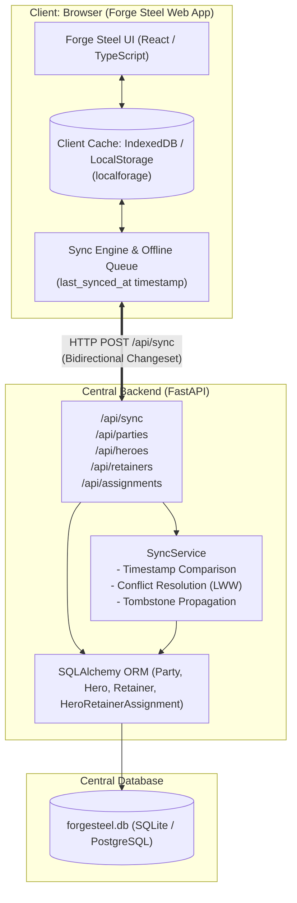

# Forge Steel: Central Hero & Retainer Database Extension

Extension for **Forge Steel** ([silverlynx18/forgesteel](https://github.com/silverlynx18/forgesteel)), the character builder and party manager for the MCDM *Draw Steel* tabletop roleplaying game.

This extension fulfills Owen's requirements documented in `Wiki/Projects/Forge Steel.md` and `Interaction Logs/2025-09-15 Jules Moved Retainers to a Shared Party List.md`.

---

## 1. Problem Context & Owen's Core Requirements

During the original 2025-09-15 implementation session, Jules made two architectural mistakes:
1. **Retainer Duplication:** Jules initially attempted to store retainers as a child array on each hero (`hero.retainers`). Owen intervened: retainers are companions with their own stat blocks, stamina, recoveries, and attack rolls, and must belong to a **shared party roster** so that **one retainer can accompany multiple heroes across sessions** without duplicating sheets or losing track of current stamina and resources.
2. **Abandoned Backend:** Jules attempted an Express backend for the central database, ran into environment errors, and abandoned the central database altogether by running a `git reset` back to the browser-only retainer feature.

### Owen's Requirements Fulfilled Here:
- **Shared Party Retainers:** Retainers belong to a central party roster (`Party.retainers`). They are not locked as private sub-objects of a single hero.
- **Multi-Hero Association:** Retainers can accompany multiple heroes in a party concurrently or across different game sessions via `HeroRetainerAssignment`. Querying a hero returns their assigned retainers; querying a retainer returns all heroes they accompany.
- **Independent Stat Block & Combat Tracking:** Retainers track Draw Steel characteristics (Might, Agility, Reason, Intuition, Presence), maximum/current/temporary stamina, recoveries, and attack abilities with Tier 1/2/3 outcomes.
- **Central Database with Offline Browser Sync:** Central REST API (FastAPI + SQLAlchemy) with a bidirectional sync engine that reconciles with client browser caches (IndexedDB / LocalStorage via `localforage`), supporting seamless offline play, timestamp tracking, and conflict resolution.

---

## 2. Architecture Overview



---

## 3. Data Models (`models.py`)

### Entities

| Entity | Description | Key Fields |
|---|---|---|
| `Party` | Adventuring party company roster | `id`, `name`, `description`, `heroes`, `retainers`, `updated_at`, `version`, `is_deleted` |
| `Hero` | Player character sheet | `id`, `party_id`, `name`, `ancestry`, `hero_class`, `level`, `stats`, `stamina_max`, `stamina_current`, `recoveries_max`, `recoveries_current`, `speed`, `stability`, `victories` |
| `Retainer` | Companion NPC sheet in party roster | `id`, `party_id`, `name`, `retainer_type` (Soldier, Scout, Sage, etc.), `level`, `stats`, `stamina_max`, `stamina_current`, `stamina_temp`, `recoveries_max`, `recoveries_current`, `abilities` |
| `HeroRetainerAssignment` | Many-to-many companionship linkage | `id`, `hero_id`, `retainer_id`, `session_id`, `role_description`, `active`, `assigned_at` |

### Draw Steel Characteristics & Abilities

- **Stats Schema:**
  ```json
  {
    "might": 2,
    "agility": 1,
    "reason": 0,
    "intuition": 1,
    "presence": 0
  }
  ```
- **Ability Schema (Tiered Outcomes):**
  ```json
  {
    "name": "Shield Slam",
    "type": "action",
    "distance": "Melee 1",
    "target": "1 creature",
    "characteristic": "might",
    "roll_bonus": 2,
    "tier_1": "3 damage",
    "tier_2": "6 damage",
    "tier_3": "9 damage + target prone",
    "description": "The retainer bashes their shield into the foe."
  }
  ```

---

## 4. Bidirectional Sync Protocol (`sync_service.py`)

The sync protocol enables offline play and multi-device access without data loss.

### Protocol Steps:
1. **Client Request (`POST /api/sync`):**
   - `client_id`: Unique identifier for client machine/browser instance.
   - `last_synced_at`: Server timestamp received during previous sync (`null` on first run).
   - `changes`: Sets of `parties`, `heroes`, `retainers`, and `assignments` created, edited, or marked deleted (`is_deleted: true`) while offline.
2. **Server Ingestion & Reconciliation:**
   - **New records:** Inserted into central database with `version = 1`.
   - **Existing records with no concurrent edit:** Updated cleanly; version incremented.
   - **Concurrent updates (Conflict):** Occurs if `server.updated_at > last_synced_at`.
     - *Client timestamp > Server timestamp:* Client wins (Last-Write-Wins); client edit applied, `ConflictDetail` returned with `resolution: "CLIENT_APPLIED"`.
     - *Client timestamp <= Server timestamp:* Server wins; server state preserved, `ConflictDetail` returned with `resolution: "SERVER_PRESERVED"`.
   - **Tombstoning:** Soft-deleted records retain `is_deleted = true` so deletions propagate to all clients without resurrections.
3. **Server Response:**
   - `sync_timestamp`: Authoritative server UTC timestamp (client updates its `last_synced_at`).
   - `applied_count`: Count of client mutations accepted.
   - `conflicts`: Array of detected conflicts and resolutions.
   - `server_changes`: All mutations committed on the server since `last_synced_at`.

---

## 5. API Endpoints (`server.py`)

### Parties & Rosters
- `POST /api/parties`: Create party.
- `GET /api/parties`: List parties.
- `GET /api/parties/{party_id}`: Get party details.
- `PUT /api/parties/{party_id}`: Update party details.
- `DELETE /api/parties/{party_id}`: Soft delete party.
- `GET /api/parties/{party_id}/roster`: Return composite party roster (party info, all heroes, all shared retainers, and active assignments).

### Heroes
- `POST /api/heroes`: Create hero.
- `GET /api/heroes`: List heroes (filter by `party_id`, `user_id`).
- `GET /api/heroes/{hero_id}`: Get hero sheet.
- `PUT /api/heroes/{hero_id}`: Update stats, stamina, level, recoveries, etc.
- `DELETE /api/heroes/{hero_id}`: Soft delete hero.
- `GET /api/heroes/{hero_id}/retainers`: Get all retainers assigned to this hero.

### Retainers (Shared Party Roster)
- `POST /api/retainers`: Create retainer in shared roster.
- `GET /api/retainers`: List retainers (filter by `party_id`).
- `GET /api/retainers/{retainer_id}`: Get retainer sheet (stats, stamina, recoveries, attacks).
- `PUT /api/retainers/{retainer_id}`: Update retainer stats, stamina, or abilities.
- `DELETE /api/retainers/{retainer_id}`: Soft delete retainer.
- `GET /api/retainers/{retainer_id}/heroes`: Query all heroes accompanied by this shared retainer.

### Assignments
- `POST /api/assignments`: Assign retainer to hero (with `session_id`, `role_description`).
- `GET /api/assignments`: List assignments.
- `DELETE /api/assignments/{assignment_id}`: Deactivate/unassign retainer from hero.

### Sync
- `POST /api/sync`: Execute bidirectional sync.

---

## 6. Integration Guide with `silverlynx18/forgesteel`

In the Forge Steel web application (`silverlynx18/forgesteel`), heroes and retainers are cached using browser storage (`localforage` / IndexedDB).

### Client Sync Adapter (TypeScript)

Add this adapter to `src/services/centralSyncService.ts`:

```typescript
import localforage from 'localforage';

export interface SyncPayload {
  client_id: string;
  last_synced_at: string | null;
  changes: {
    parties: any[];
    heroes: any[];
    retainers: any[];
    assignments: any[];
  };
}

const API_BASE = process.env.REACT_APP_CENTRAL_DB_URL || 'http://localhost:8000';

export async function syncWithCentralDatabase(): Promise<void> {
  const lastSyncedAt = await localforage.getItem<string>('forgesteel_last_synced_at');
  const dirtyHeroes = (await localforage.getItem<any[]>('dirty_heroes')) || [];
  const dirtyRetainers = (await localforage.getItem<any[]>('dirty_retainers')) || [];
  const dirtyParties = (await localforage.getItem<any[]>('dirty_parties')) || [];
  const dirtyAssignments = (await localforage.getItem<any[]>('dirty_assignments')) || [];

  const payload: SyncPayload = {
    client_id: 'browser-' + window.navigator.userAgent,
    last_synced_at: lastSyncedAt || null,
    changes: {
      parties: dirtyParties,
      heroes: dirtyHeroes,
      retainers: dirtyRetainers,
      assignments: dirtyAssignments,
    },
  };

  try {
    const res = await fetch(`${API_BASE}/api/sync`, {
      method: 'POST',
      headers: { 'Content-Type': 'application/json' },
      body: JSON.stringify(payload),
    });

    if (!res.ok) throw new Error(`Sync failed: ${res.statusText}`);

    const data = await res.json();

    // 1. Update local client cache with server changes
    for (const hero of data.server_changes.heroes) {
      if (hero.is_deleted) {
        await localforage.removeItem(`hero_${hero.id}`);
      } else {
        await localforage.setItem(`hero_${hero.id}`, hero);
      }
    }

    for (const retainer of data.server_changes.retainers) {
      if (retainer.is_deleted) {
        await localforage.removeItem(`retainer_${retainer.id}`);
      } else {
        await localforage.setItem(`retainer_${retainer.id}`, retainer);
      }
    }

    // 2. Clear outbox dirty queues
    await localforage.setItem('dirty_heroes', []);
    await localforage.setItem('dirty_retainers', []);
    await localforage.setItem('dirty_parties', []);
    await localforage.setItem('dirty_assignments', []);

    // 3. Save new sync cursor timestamp
    await localforage.setItem('forgesteel_last_synced_at', data.sync_timestamp);
    console.log(`[Forge Steel Sync] Synced successfully. Applied: ${data.applied_count}`);
  } catch (err) {
    console.warn('[Forge Steel Sync] Offline or server unreachable; continuing with local cache.');
  }
}
```

---

## 7. Setup & Execution

### Environment Setup
Activate the virtual environment or run with Python 3.13:

```bash
cd /Users/owenmartin/Documents/Gemini-export/work/projects/forgesteel
source .venv/bin/activate
```

### Running the Server
```bash
uvicorn server:app --reload --port 8000
```
Open interactive Swagger API documentation at: `http://localhost:8000/docs`

### Running the Test Suite
```bash
pytest -v
```
All 12 tests verify shared party rosters, multi-hero association, independent retainer stamina/stats, and offline sync conflict resolution.
